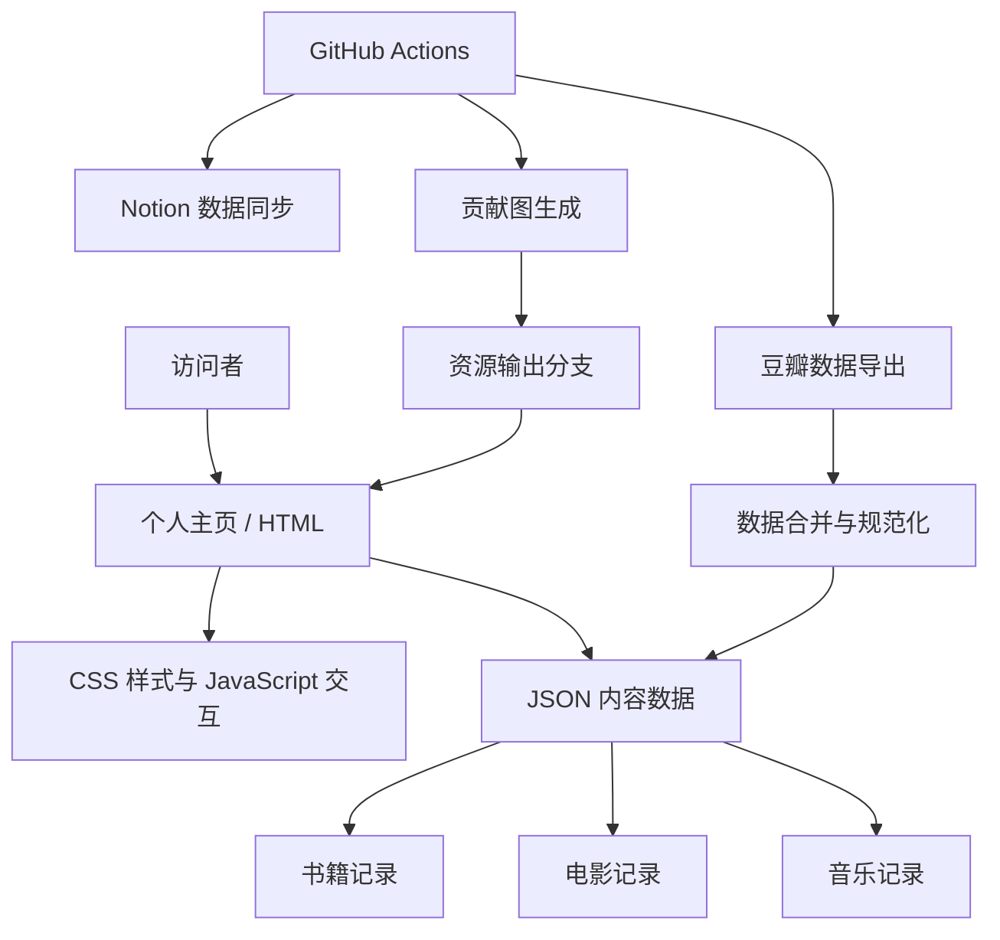

<div align="center">

# LiKui · Personal Hub

**个人数字门户｜开源项目展示｜知识与生活记录**

将技术实践、数字空间与日常积累汇聚于一处。

<p>
  <a href="https://likui.info/"></a>
  <a href="https://github.com/ilikui/home"></a>
</p>
<p>
  
  
  
  
  
</p>

[在线主页](https://likui.info/) · [个人介绍](https://about.likui.info/) · [GitHub 主页](https://github.com/ilikui)

</div>

---

## 项目简介

**LiKui Personal Hub** 是一个以个人主页为入口的轻量级数字门户。它把个人介绍、技术兴趣、开源项目、个人站点以及书影音记录组织为统一的浏览体验，并借助自动化工作流维护部分数据与展示资源。

项目坚持 **内容清晰、结构简洁、数据可维护、持续迭代** 的设计原则。网站以原生 Web 技术为基础，避免不必要的框架依赖，让内容维护、功能调整与部署流程保持直接、透明。

> **持续积累，持续创造。**  
> 让每一次学习、实践与记录，都成为个人数字资产的一部分。

## 项目亮点

<table>
  <tr>
    <td width="50%">
      <strong>01 · Personal Portal</strong><br>
      统一入口连接个人介绍、数字空间、技术站点与开源项目。
    </td>
    <td width="50%">
      <strong>02 · Knowledge & Interests</strong><br>
      集中呈现技术方向、个人收藏以及持续积累的内容记录。
    </td>
  </tr>
  <tr>
    <td width="50%">
      <strong>03 · Data-driven Content</strong><br>
      通过 JSON 管理书籍、电影与音乐数据，降低内容维护成本。
    </td>
    <td width="50%">
      <strong>04 · Workflow Automation</strong><br>
      使用 GitHub Actions 执行数据同步与贡献图资源生成任务。
    </td>
  </tr>
</table>

---

## 目录

- [项目概述](#项目概述)
- [功能模块](#功能模块)
- [技术架构](#技术架构)
- [目录结构](#目录结构)
- [书影音数据规范](#书影音数据规范)
- [自动化工作流](#自动化工作流)
- [本地开发](#本地开发)
- [部署指南](#部署指南)
- [故障排查](#故障排查)
- [变更检查清单](#变更检查清单)
- [第三方项目与许可](#第三方项目与许可)

## 项目概述

本项目采用原生 Web 技术构建，定位为轻量、易维护的个人门户。页面内容与结构化数据分离，便于独立维护站点样式、交互逻辑及个人收藏记录。

项目设计目标如下：

- **信息组织清晰：** 统一呈现个人介绍、数字空间、技术兴趣及开源项目。
- **轻量化实现：** 主要使用 HTML、CSS、JavaScript 与 JSON，不依赖大型前端框架。
- **多终端适配：** 支持桌面端和移动端访问，并提供主题切换等交互功能。
- **数据独立维护：** 书籍、电影和音乐记录以 JSON 文件存储，供页面读取和展示。
- **自动化运维：** 使用 GitHub Actions 执行豆瓣数据同步、Notion 数据同步及贡献图资源生成等任务。

## 功能模块

| 模块 | 功能说明 |
| --- | --- |
| 个人介绍 | 展示个人简介、关注方向及相关入口 |
| 数字空间 | 汇总笔记、博客、RSS 等个人站点 |
| 项目与记录 | 展示开源项目及个人实践成果 |
| 技术栈 | 呈现技术兴趣与相关技术资源链接 |
| 书影音 | 展示书籍、电影和音乐记录，并支持按类别及状态筛选 |
| GitHub 贡献图 | 展示由自动化工作流生成的贡献图资源 |

## 系统架构图



架构图展示仓库内页面、数据与自动化任务之间的主要关系；实际执行行为以工作流文件及其运行日志为准。

## 技术架构

| 层次 | 技术或工具 | 职责 |
| --- | --- | --- |
| 页面结构 | HTML5 | 定义页面内容与语义结构 |
| 页面样式 | CSS3 | 实现布局、响应式样式及主题表现 |
| 页面交互 | 原生 JavaScript | 实现导航、筛选及其他客户端交互 |
| 数据存储 | JSON | 存储书影音记录及相关页面数据 |
| 自动化执行 | GitHub Actions | 定时执行、手动触发数据同步及资源生成任务 |
| 豆瓣数据导出 | [doumark-action](https://github.com/lizheming/doumark-action) | 导出书籍、电影和音乐记录 |
| 贡献图生成 | [snk](https://github.com/Platane/snk) | 生成 GitHub 贡献图动画资源 |

本项目按静态网站方式组织。日常本地预览无需安装前端构建工具；使用 Python 或其他静态文件 HTTP 服务即可运行页面。

## 目录结构

```text
home/
├── index.html                       # 个人主页入口
├── favicon.ico                      # 站点图标
├── douban/
│   └── db.html                      # 书影音展示页面
├── static/
│   ├── css/                         # 样式文件
│   ├── js/                          # 页面交互脚本
│   ├── img/                         # 图片资源
│   ├── svg/                         # SVG 资源
│   └── data/
│       ├── book.json                # 书籍数据
│       ├── movie.json               # 电影数据
│       ├── music.json               # 音乐数据
│       └── douban/                  # 豆瓣数据备份
├── scripts/
│   └── merge_douban_data.py         # 豆瓣导出数据合并与规范化脚本
└── .github/
    └── workflows/
        ├── douban.yml               # 豆瓣数据同步
        ├── sync.yml                 # 豆瓣记录同步至 Notion
        └── manual_run.yml           # 生成贡献图并发布输出资源
```

## 书影音数据规范

书影音页面主要读取以下文件：

- 书籍：[`static/data/book.json`](static/data/book.json)
- 电影：[`static/data/movie.json`](static/data/movie.json)
- 音乐：[`static/data/music.json`](static/data/music.json)
- 展示页面：[`douban/db.html`](douban/db.html)

数据文件应为合法 JSON 数组。记录沿用豆瓣导出字段，并使用 `status` 和 `media_type` 等字段描述条目状态及媒介类型。

### 状态枚举

| JSON 状态值 | 定义 | 页面展示文案示例 |
| --- | --- | --- |
| `mark` | 已标记，尚未开始 | 想读、想看、想听 |
| `doing` | 正在进行 | 在读、在看、在听 |
| `done` | 已完成 | 读完、看完、听完 |

**数据约束：**

1. `status` 字段统一使用 `mark`、`doing`、`done`，不得将中文展示文案直接作为状态值。
2. 页面应根据媒介类型，将统一状态映射为相应的展示文案。
3. 修改数据后，应检查 JSON 语法、状态枚举、条目重复情况及封面资源链接。
4. 如通过自动化工作流更新数据，应同时检查工作流日志和提交差异，确认数据没有意外丢失。

## 自动化工作流

### 豆瓣数据同步

工作流文件：[`.github/workflows/douban.yml`](.github/workflows/douban.yml)

该工作流通过 `lizheming/doumark-action` 导出书籍、电影和音乐记录，并调用 `scripts/merge_douban_data.py` 合并与规范化数据，最终更新 `static/data/` 下的 JSON 文件。工作流支持配置的定时运行及手动触发，并会在同步前备份现有数据。

当某一媒介类型未返回记录时，合并脚本会保护已有数据，避免空结果直接覆盖现有收藏。发生异常时，应优先检查 GitHub Actions 日志、导出结果及合并脚本输出。

### Notion 数据同步

工作流文件：[`.github/workflows/sync.yml`](.github/workflows/sync.yml)

该工作流用于将豆瓣书籍、电影和音乐记录同步至指定的 Notion 数据库。运行前需在 GitHub 仓库的 **Settings → Secrets and variables → Actions** 中配置：

- `notion_token`：具有目标数据库访问权限的 Notion Integration Token。

目标数据库标识由工作流中的 `dir` 配置维护。请确认 Notion Integration 已获得目标数据库的访问权限，并遵循最小权限原则。令牌等敏感信息不得写入源码或提交至仓库。

### GitHub 贡献图生成

工作流文件：[`.github/workflows/manual_run.yml`](.github/workflows/manual_run.yml)

该工作流调用 [Platane/snk](https://github.com/Platane/snk) 生成 SVG、GIF 等贡献图资源，并将生成结果发布至 `manual-run-output` 分支。

若页面未能正常显示贡献图，请依次检查：

1. GitHub Actions 最近一次执行结果；
2. `manual-run-output` 分支中的生成文件及目录；
3. 页面资源引用路径与实际输出路径是否一致；
4. 浏览器缓存及资源请求状态。

## 本地开发

建议通过 HTTP 服务运行页面，以确保以域名根路径为基准的资源引用能够正常解析。请先安装 Git 和 Python 3，然后执行：

```bash
git clone https://github.com/ilikui/home.git
cd home
python -m http.server 8000
```

启动后访问 <http://localhost:8000>。

修改页面、样式或脚本后，可刷新浏览器进行检查。修改书影音数据后，应验证数据加载、状态筛选及封面显示是否正常。

## 部署指南

本项目为静态网站，可部署至 Nginx、Apache、GitHub Pages 或其他静态托管平台。

1. 将仓库中的站点文件发布至目标站点目录。
2. 确认域名解析、HTTPS 配置及静态资源访问路径正确。
3. 当前资源引用按部署在域名根路径的场景设计；若部署至子目录，需检查并调整相关路径。
4. 验证首页、书影音页面、主题切换、状态筛选、外部链接及移动端布局。
5. 如需运行数据同步任务，确认 GitHub Actions 已启用，并检查仓库权限、工作流配置及所需 Secrets。
6. 发布后检查浏览器开发者工具中的控制台和网络请求，及时处理资源 404、JSON 解析失败等问题。

## 故障排查

| 问题表现 | 检查方向 |
| --- | --- |
| 页面样式未加载 | 检查 `static/css/` 路径、文件名大小写、部署目录和浏览器缓存 |
| 书影音内容为空 | 检查 JSON 语法、请求路径及浏览器控制台错误 |
| 状态筛选异常 | 检查 `status` 是否为 `mark`、`doing` 或 `done` |
| 数据出现重复 | 检查豆瓣导出结果及 `scripts/merge_douban_data.py` 的合并逻辑 |
| Actions 执行失败 | 检查工作流日志、第三方 Action 输出、令牌权限和仓库写入权限 |
| Notion 数据未更新 | 检查 `notion_token`、目标数据库标识及 Integration 的访问权限 |
| 贡献图未显示 | 检查输出分支、生成文件、页面引用路径及缓存 |

## 变更检查清单

提交代码或数据变更前，建议完成以下检查：

- [ ] JSON 文件语法正确，状态值符合数据规范。
- [ ] 页面引用的 CSS、JavaScript、图片和数据文件路径有效。
- [ ] 桌面端与移动端布局显示正常。
- [ ] 主题切换、导航、书影音筛选等现有功能未受影响。
- [ ] 未提交令牌、密码或其他敏感凭据。
- [ ] 涉及自动化工作流的变更已通过 GitHub Actions 执行结果验证。
- [ ] 检查变更差异，确认未意外删除页面内容或收藏数据。

## 第三方项目与许可

本项目使用或参考以下第三方工具：

- [lizheming/doumark-action](https://github.com/lizheming/doumark-action)：豆瓣记录导出与同步。
- [Platane/snk](https://github.com/Platane/snk)：GitHub 贡献图资源生成。
- GitHub Actions：自动化任务执行。

第三方项目、代码及素材均应遵循各自适用的许可证和使用条款。复用相关资源前，请确认其授权范围及署名要求。


## 每日 GitHub 热门仓库

主页新增 **GitHub 热门仓库**入口，访问 [GitHub Trending](https://likui.info/github-trending.html) 查看每日开源项目精选。页面支持按 28 个技术领域、编程语言和关键词组合筛选，并展示仓库简介、主要语言、Star、Fork、开放 Issue 与 Topics。分类采集覆盖 AI/LLM、Agent、机器学习、Python、C/C++、Java/Kotlin、JavaScript/TypeScript、前后端、Go、Rust、PHP、移动应用、嵌入式/IoT、AUTOSAR/汽车电子、自动驾驶、机器人、数据库、数据工程、云原生、网络安全、测试、开发工具、操作系统、游戏图形、设计多媒体、区块链和学习教程。一个仓库可同时属于多个领域。

### 自动化实现

- 工作流：[`.github/workflows/github-trending.yml`](.github/workflows/github-trending.yml)
- 数据采集脚本：[`scripts/update_github_trending.py`](scripts/update_github_trending.py)
- 页面：[`github-trending.html`](github-trending.html)
- 数据快照：[`static/data/github-trending.json`](static/data/github-trending.json)

工作流每天 UTC 00:20（北京时间 08:20）执行，也支持手动触发。运行时使用 GitHub Search API 更新 JSON 数据并提交回 `main`；HTML 页面独立负责渲染仓库卡片与交互式筛选，因此每日更新不会覆盖筛选功能。采集数据合并最近 7 天新建项目与最近 90 天有更新的热门项目，并按 28 个技术领域分别检索、去重后汇总，避免榜单只包含最近一周创建的少量仓库。仓库默认的 `GITHUB_TOKEN` 由 Actions 提供。若 API 限额或网络请求失败，任务会失败并在 Actions 日志中报告，不会把空结果当作成功数据覆盖。

首次启用后，可打开仓库 **Actions → Daily GitHub Trending → Run workflow** 手动生成第一份榜单。GitHub Search API 的结果代表可检索的近期热门项目，并非 GitHub 官方 Trending 页面所使用的内部排名。


## RSS 新闻热点

主页新增独立的 **RSS 新闻热点**页面，用于汇聚公开 RSS/Atom 信息源，并按分类和关键词浏览最新内容。

- 页面：[`news.html`](news.html)
- RSS 聚合脚本：[`scripts/update_news.py`](scripts/update_news.py)
- 新闻数据：[`static/data/news.json`](static/data/news.json)
- 自动更新工作流：[`.github/workflows/rss-news.yml`](.github/workflows/rss-news.yml)

### 功能

- 聚合科技、人工智能、国际新闻与开源动态等多个公开 RSS/Atom 信息源。
- 按内容分类筛选，支持标题、摘要和来源关键词搜索。
- 支持最新发布排序、来源排序和浅色/深色主题切换。
- 新闻卡片保留原始来源与链接，点击后跳转发布方原文。
- GitHub Actions 每天北京时间约 08:35 自动抓取并更新 JSON 数据，同时支持手动运行。

### 数据更新与可靠性

工作流运行 `python scripts/update_news.py`，解析 RSS/Atom XML，规范化发布时间、去重并输出最多 180 条新闻至 `static/data/news.json`。如果所有信息源均不可用，脚本会以失败状态退出并保留已有数据，避免用空结果覆盖有效新闻。个别来源失败时会记录失败信息，并继续处理其他可用来源。

首次部署后，可进入仓库 **Actions → Daily RSS News Digest → Run workflow** 手动运行。若页面暂时没有新闻，请检查该工作流的执行日志、`static/data/news.json` 是否已生成有效条目，以及部署平台是否已发布最新提交。RSS 源的可用性、更新频率和内容范围由各发布方决定；聚合页仅作阅读入口，内容版权归原发布方所有。

